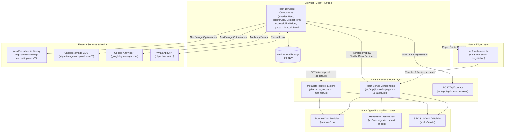
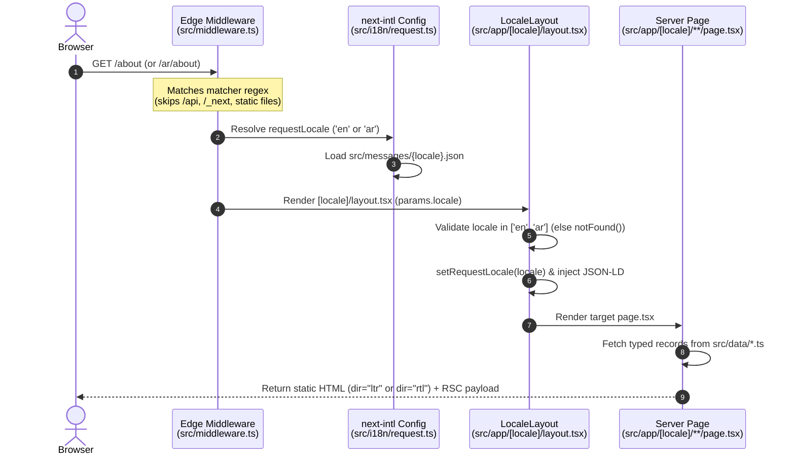
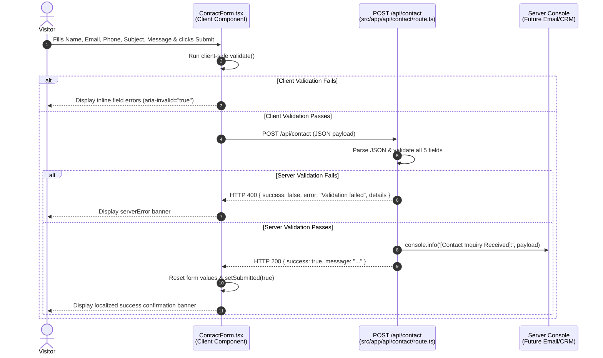
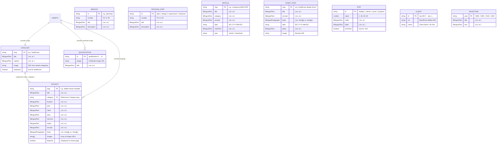

# KFO — Khaled Alfagih Engineering Consultancy Company Website (`kfoco-website`)

A modern, responsive, bilingual (**English LTR** & **Arabic RTL**) corporate marketing and portfolio web application built for **Khaled Alfagih Engineering Consultancy Company (KFO)** in Riyadh, Saudi Arabia.

Built with **Next.js 14 (App Router)**, **TypeScript**, **Tailwind CSS**, **next-intl**, **Framer Motion**, and **Lenis**, the application delivers a "Quiet Authority" architectural editorial experience with static site generation (SSG), comprehensive technical SEO (`hreflang`, `sitemap.xml`, `robots.txt`, Web App Manifest, JSON-LD `Organization` & `LocalBusiness` structured data), an interactive client-side accessibility suite, and a server-validated contact inquiry API.

---

## Table of Contents

- [A. Project Overview](#a-project-overview)
- [B. Technology Stack](#b-technology-stack)
- [C. Features and Functionality](#c-features-and-functionality)
- [D. Project Architecture](#d-project-architecture)
- [E. Complete Folder and File Structure](#e-complete-folder-and-file-structure)
- [F. Installation and Local Setup](#f-installation-and-local-setup)
- [G. Environment Variables](#g-environment-variables)
- [H. API Documentation](#h-api-documentation)
- [I. Database and Data Layer Documentation](#i-database-and-data-layer-documentation)
- [J. Authentication and Security](#j-authentication-and-security)
- [K. Frontend Documentation](#k-frontend-documentation)
- [L. Backend and Server-Side Documentation](#l-backend-and-server-side-documentation)
- [M. Testing and Quality Assurance](#m-testing-and-quality-assurance)
- [N. Build, Deployment, and Production](#n-build-deployment-and-production)
- [O. Troubleshooting](#o-troubleshooting)
- [P. Development Guidelines](#p-development-guidelines)
- [Q. Known Limitations and Future Improvements](#q-known-limitations-and-future-improvements)
- [R. Useful Commands](#r-useful-commands)

---

## A. Project Overview

### 1. Project Name and Purpose
- **Package Name:** `kfoco-website` (`v1.0.0`)
- **Organization:** Khaled Alfagih Engineering Consultancy Company (**شركة خالد الفقيه للاستشارات الهندسية** — **KFO**)
- **Purpose:** Serve as the primary bilingual digital presence, project portfolio, knowledge center, and lead-generation platform for KFO, an engineering consultancy firm with **29+ years of experience** in Riyadh, Saudi Arabia, specializing in healthcare facility planning, architectural & engineering design, renovation, and execution supervision.

### 2. What Problem It Solves
The project modernizes KFO's legacy WordPress website into a high-performance, statically generated Next.js application:
- **Bilingual Parity & True RTL Engineering:** Eliminates broken layouts between English (`ltr`) and Arabic (`rtl`) by using CSS logical properties (`ms-*`, `me-*`, `ps-*`, `pe-*`, `start-*`, `end-*`), locale-aware typography remapping, and automatic directional icon mirroring.
- **Data Integrity & No Hallucinated Content:** Centralizes all domain content in strictly typed TypeScript modules (`src/data/*.ts`) and translation dictionaries (`src/messages/*.json`). Unverified client facts are explicitly flagged with `TODO:` prefixes and rendered on-screen via the `<TodoText />` component with a dashed gold underline (`.todo-mark`) so stakeholders can audit and supply verified data before launch.
- **Editorial Performance & Accessibility:** Combines architectural motion design (Ken-Burns hero, staggered scroll reveals, count-up metrics, dual-row marquee) with strict `prefers-reduced-motion` compliance and a persistent on-page Accessibility Widget.

### 3. Main Capabilities
- **Bilingual Routing (`en` / `ar`):** Seamless switching between English at root paths (`/`, `/about`, `/projects`) and Arabic under `/ar` (`/ar`, `/ar/about`, `/ar/projects`) while preserving the active route.
- **8 Architectural Sector Portals:** Dedicated landing pages and portfolio filtering for Healthcare (core emphasized specialty), Education, Residential, Industrial, Hospitality, Offices Building, Transportation, and Interior.
- **Project Case Studies & Lightbox Galleries:** Detailed project views with metadata sidebars, responsive image grids, keyboard-navigable full-screen lightboxes, and circular previous/next pagination.
- **Interactive Knowledge Center & Events:** Client-side instant search and category chip filtering for articles and PDF downloads (such as the official `KFO_2025.pdf` Company Profile).
- **Lead Generation & Direct Contact:** Client- and server-validated inquiry form (`POST /api/contact`) alongside direct WhatsApp click-to-chat integration.

### 4. Target Users and Use Cases
- **Healthcare Operators & Hospital Owners:** Evaluating KFO's healthcare facility planning, medical complex design, and Balady 2nd-class classification credentials.
- **Government Bodies, Real Estate Developers & Investors:** Browsing sector capabilities, past client partnerships, certifications, and downloading the 2025 Company Profile PDF.
- **Project Managers & Partners:** Reading technical checklists/guides in the Knowledge Center, tracking KFO industry event participation, and initiating project inquiries.

### 5. Current Implementation Status
- **UI, Layout, Routing, i18n, SEO & Build Pipeline:** **100% Implemented.** All 13 App Router page/route templates, Edge middleware, SEO generators, custom binary icon/OG asset generator, and UI components are complete.
- **Content & Photography:** **Partially Implemented (Structured & Flagged).** Core company stats (`29+` years, `50+` projects, `35+` clients, `2nd` Balady classification), 4 core services, 4 process steps, primary brand logo, hero slide 1, 30 WordPress client logo URLs, and the 2025 Company Profile PDF link are populated from the live site. Detailed project metadata, additional photography, scanned certificates, timeline milestone details, full street address, and Knowledge Center/Events full texts contain explicit `TODO:` placeholders awaiting final client assets.
- **Contact Form Delivery:** **Partially Implemented.** Both the frontend form (`src/components/sections/shared/ContactForm.tsx`) and the backend route handler (`src/app/api/contact/route.ts`) are implemented and connected via `fetch('/api/contact')`, performing validation and server logging, but third-party transactional email/CRM delivery (Resend, Formspree, or webhook) awaits credentials.

---

## B. Technology Stack

### 1. Core Frameworks & Languages

| Layer | Technology | Version | Role in Project |
| :--- | :--- | :--- | :--- |
| **Framework** | [Next.js](https://nextjs.org/) (App Router) | `^14.2.35` | Full-stack React framework providing Server Components, Static Site Generation (`generateStaticParams`), Metadata API routes (`sitemap.ts`, `robots.ts`, `manifest.ts`), Edge Middleware, and the `/api/contact` Node.js route handler. |
| **UI Library** | [React](https://react.dev/) & `react-dom` | `18.3.1` | Component architecture combining Server Components (pages, layouts, SEO) and Client Components (interactive widgets, forms, animations). |
| **Language** | [TypeScript](https://www.typescriptlang.org/) | `5.7.3` | Strict static typing across all components, route params, API payloads, and domain data schemas (`strict: true`). |
| **Runtime** | [Node.js](https://nodejs.org/) | `>=20` | Specified in `package.json` `engines.node`; powers the build pipeline, `/api/contact` runtime, and `.mjs` utility scripts. |

### 2. Internationalization, Styling & Motion

| Category | Technology | Version | Role in Project |
| :--- | :--- | :--- | :--- |
| **i18n & Routing** | [`next-intl`](https://next-intl-docs.vercel.app/) | `3.26.5` | Manages locale routing (`en` default at `/`, `ar` at `/ar`), middleware negotiation, server/client translation hooks (`getTranslations`, `useTranslations`), and locale-aware `<Link>` / `useRouter`. |
| **CSS Framework** | [Tailwind CSS](https://tailwindcss.com/) | `3.4.17` | Utility-first styling configured with custom "Quiet Authority" design tokens (`ink`, `navy`, `steel`, `gold`, `offwhite`, `warmgrey`, `textc`), custom keyframes (`marquee`, `kenburns`, `scrollhint`), and logical RTL utilities. |
| **CSS Processing** | PostCSS & Autoprefixer | `8.5.1` / `10.4.20` | Processes Tailwind directives (`@tailwind base/components/utilities`) and vendor prefixes via `postcss.config.mjs`. |
| **Animation** | [Framer Motion](https://www.framer.com/motion/) | `11.18.2` | Powers page transitions (`template.tsx`), scroll-triggered reveals (`Reveal.tsx`), viewport number count-up (`CountUp.tsx`), layout-animated project filtering (`ProjectsGrid.tsx`), sticky header hide/reveal, and modal transitions. |
| **Smooth Scroll** | [Lenis](https://lenis.darkroom.engineering/) | `1.1.20` | Provides inertial wheel scrolling (`SmoothScroll.tsx`), automatically bypassed when `prefers-reduced-motion: reduce` is active. |
| **Icons** | [`lucide-react`](https://lucide.dev/) | `0.469.0` | Crisp stroke icons for navigation, metadata, accessibility controls, and directional arrows (supplemented by a custom inline SVG for Pinterest in `SocialIcons.tsx`). |
| **Typography** | `next/font/google` | Built-in | Self-hosts and preloads **Playfair Display** (English serif display), **Inter** (English sans body), and **IBM Plex Sans Arabic** (Arabic display & body). |

### 3. Database, Storage & External Integrations

| Category | Implementation | Details |
| :--- | :--- | :--- |
| **Database / ORM** | **None (Static Typed Data Layer)** | Content is stored in version-controlled TypeScript modules under `src/data/*.ts` so the site compiles to static HTML/JSON and can later be wired to a headless WordPress or CMS backend. |
| **Client Storage** | `window.localStorage` | Persists user accessibility preferences under the key `kfo-a11y`. |
| **Analytics** | Google Analytics 4 (`gtag.js`) | Conditionally injected in `src/app/[locale]/layout.tsx` when `NEXT_PUBLIC_GA_ID` is set. |
| **Messaging** | WhatsApp Click-to-Chat (`wa.me`) | Configured via `NEXT_PUBLIC_WHATSAPP_NUMBER` in `src/data/site.ts` and surfaced in the floating action button, contact page, mobile menu, and footer. |
| **Remote Media** | WordPress Media Library & Unsplash | Whitelisted in `next.config.mjs` (`kfoco.com` and `images.unsplash.com`) and centralized in `src/data/assets.ts` and `src/data/clients.ts`. |
| **Hosting & CDN** | [Vercel](https://vercel.com/) | Configured via `vercel.json` and `next.config.mjs` with custom security headers and zero-config Next.js App Router support. |

---

## C. Features and Functionality

### 1. Fully Implemented Features

1. **Bilingual Locale Routing & Automatic RTL Mirroring**
   - Configured in `src/i18n/routing.ts` with `locales: ['en', 'ar']`, `defaultLocale: 'en'`, and `localePrefix: 'as-needed'`.
   - `src/app/[locale]/layout.tsx` dynamically sets `<html lang={locale} dir={locale === 'ar' ? 'rtl' : 'ltr'}>`.
   - `src/app/globals.css` remaps `--font-display` and `--font-body` to `--font-plex-arabic` when `html[lang='ar']` is active, flips button hover sweeps (`origin-left` -> `origin-right`), and reverses marquee scroll directions.
2. **Full-Viewport Architectural Hero (`src/components/sections/home/Hero.tsx`)**
   - 3-slide automatic crossfade slideshow (7-second interval) with slow Ken-Burns zoom (`animate-kenburns`).
   - Line-by-line masked headline reveal, animated gold line-draw rule, floating `+29 Years of Experience` glassmorphism badge, interactive slide indicator bars, and animated scroll hint.
3. **Smart Sticky Header & Full-Screen Mobile Menu (`Header.tsx`, `MobileMenu.tsx`)**
   - Starts transparent with white text/logo over the dark home hero (`overHero`), transitioning to a blurred white surface (`bg-white/90 shadow-header backdrop-blur-md`) after scrolling past `40px`.
   - Automatically hides on scroll down past `120px` and reveals on scroll up.
   - Full-screen mobile drawer (`MobileMenu.tsx`) locks body scroll, renders numbered navigation links (`01`–`08`) with staggered entrance animations, and provides direct phone/email/WhatsApp links and language switching.
4. **8-Category Portfolio Grid & Sector Pages (`CategoryTiles.tsx`, `[category]/page.tsx`)**
   - Home page features an asymmetric 12-column grid where **Healthcare** (`emphasis: true`) spans 2 columns and 2 rows on desktop.
   - Each of the 8 categories (`/healthcare`, `/education`, `/residential`, `/industrial`, `/hospitality`, `/offices-building`, `/transportation`, `/interior`) has a dedicated statically generated route pre-filtered to that sector.
5. **Interactive Project Explorer & Case Study Pages (`ProjectsGrid.tsx`, `projects/[slug]/page.tsx`)**
   - Category filter pills with `aria-pressed` states and Framer Motion `AnimatePresence mode="popLayout"` card transitions.
   - Individual project pages feature a 7-field metadata sidebar (Client, Location, Area, Year, Category, Services, Status), narrative paragraphs, a responsive `<ProjectGallery />` with full-screen `<Lightbox />` (supporting `Escape`, `ArrowLeft`, and `ArrowRight` with RTL direction awareness), and circular Previous/Next project navigation.
6. **Animated Statistics & Qualifications Lightbox (`StatsSection.tsx`, `QualificationsGallery.tsx`)**
   - Viewport-triggered `<CountUp />` animation (ease-out quart over `1600ms`) rendering Western numerals in both locales, with special handling for ordinal rankings (`2nd` Balady Classification).
   - 8-certificate grid that opens scanned qualification documents in the keyboard-accessible `<Lightbox />`.
7. **Dual-Row Opposite-Direction Client Marquee (`ClientsMarquee.tsx`, `our-clients/page.tsx`)**
   - Splits 30 client logo assets into two tracks (`clientsRowA` and `clientsRowB`) scrolling in opposite directions (`55s` and `85s` loops), pausing on hover, and transitioning from grayscale to full color with `mix-blend-multiply`.
   - Dedicated `/our-clients` page displays all 30 logos in a 5-column responsive grid.
8. **Knowledge Center Search & Filter (`KnowledgeExplorer.tsx`, `knowledge-center/[slug]/page.tsx`)**
   - Real-time client-side search matching English and Arabic titles and excerpts, paired with dynamic category chip filtering (`All`, `Healthcare`, `Supervision`, `Downloads`, `Practice`).
   - Supports both standard articles and direct PDF download items (`type: 'download'`).
9. **Client & Server Contact Inquiry Workflow (`ContactForm.tsx`, `src/app/api/contact/route.ts`)**
   - Client-side validation with accessible field error associations (`aria-invalid`, `aria-describedby`) and localized validation messages.
   - Submits JSON via `POST /api/contact` to a Node.js Route Handler that re-validates all 5 fields (`name`, `email`, `phone`, `subject`, `message` >= 10 chars) and returns structured JSON responses.
10. **Persistent Accessibility Widget (`AccessibilityWidget.tsx`)**
    - Floating bottom-start panel providing 6 toggles: Increase Text (`120%`), Decrease Text (`90%`, mutually exclusive with Increase Text), High Contrast (`contrast(1.35)`), Grayscale (`grayscale(1)`), Underline Links, and Readable System Font.
    - Persists active classes to `localStorage` (`kfo-a11y`) and applies them directly to `document.documentElement`.
11. **Technical SEO & Structured Data (`src/lib/seo.ts`, `sitemap.ts`, `robots.ts`, `manifest.ts`)**
    - Generates canonical URLs, `hreflang` alternates (`en-SA`, `ar-SA`, `en`, `ar`, `x-default`), Open Graph tags, and Twitter Cards for every route.
    - Injects Schema.org `@graph` containing `Organization` and `LocalBusiness` JSON-LD into every page layout.
    - Dynamically generates `/sitemap.xml` (25 localized route entries with alternates), `/robots.txt`, and `/manifest.webmanifest`.
12. **Zero-Dependency Binary Asset Generator & Deployment Verifier (`scripts/*.mjs`)**
    - `scripts/generate-assets.mjs` generates valid raw PNG (`icon.png`, `apple-icon.png`, `opengraph-image.png`) and ICO (`favicon.ico`) binaries using only built-in Node.js `fs`, `zlib`, and custom CRC32/IHDR/IDAT chunk encoders.
    - `scripts/verify-deployment.mjs` smoke-tests 24 GET endpoints (verifying HTTP 200 and Arabic `dir="rtl"` / `lang="ar"` attributes) plus `POST /api/contact`.

### 2. Partially Implemented Features (Verified in Code)

1. **Contact Form Email / CRM Dispatch (`src/app/api/contact/route.ts`)**
   - **Current State:** Validates incoming JSON payloads and logs the sanitized inquiry to `console.info('[Contact Inquiry Received]:', ...)`, then returns HTTP `200`.
   - **Remaining Work:** Uncomment and configure one of the three documented integration patterns in `src/app/api/contact/route.ts` (Resend API, Formspree/EmailJS, or CRM Webhook). Additionally, update `form.success` in `src/messages/en.json` and `src/messages/ar.json` (which currently still mentions `TODO: connect this form to the client's email endpoint or CRM`).
2. **Placeholder Content & Photography (`src/data/*.ts`, `src/messages/*.json`)**
   - **Current State:** Content fields that have not yet been formally verified by KFO are prefixed with `TODO:` and rendered via `<TodoText />` with a dashed gold underline (`.todo-mark`).
   - **Items Awaiting Official Client Assets:**
     - **Projects (`src/data/projects.ts`):** Location, year, client name, built-up area, services provided, completion status, official descriptions, and gallery photos for *Dallah Namar Hospital*, *Dr. Mohamed Alfagih Hospital*, and *Al Hammadi Medical Complex*, plus projects for the remaining 7 categories.
     - **Photography (`src/data/assets.ts`):** Hero slides 2 & 3, About image, CTA background, 7 inner page header banners, 8 category tile images, project gallery photos, and 8 qualification certificate scans currently use Unsplash placeholders.
     - **Client Names (`src/data/clients.ts`):** All 30 client logos load from `https://kfoco.com/wp-content/uploads/...`, but their `name` (alt text) fields are set to `TODO: Client logo 1`–`30`.
     - **Company Narrative (`src/data/timeline.ts`, `src/messages/*.json`):** Founding year (`1996`) and milestone details, official Vision & Mission statements, full street address, and working hours.
     - **Knowledge Center & Events (`src/data/articles.ts`, `src/data/events.ts`, `knowledge-center/[slug]/page.tsx`):** Article bodies, excerpts, and event write-ups/venues are structural placeholders.
3. **Interactive Office Map (`src/app/[locale]/contact/page.tsx`, `src/components/layout/Footer.tsx`)**
   - **Current State:** Renders a styled placeholder container (and grayscale map placeholder image on `/contact`) with `mapPlaceholder` text.
   - **Remaining Work:** Replace with an embedded Google Maps `<iframe>` once exact office coordinates and street address are confirmed.

### 3. Unused or Unwired Code Elements (Supported by Code Evidence)

- **`TopBar` Component (`src/components/layout/TopBar.tsx`):** Fully implemented desktop utility bar with phone, email, WhatsApp, social icons, and `LanguageSwitcher`, but **not currently imported** in `src/app/[locale]/layout.tsx` (which mounts `<Header />` directly).
- **White Brand Logo Asset (`src/app/globals.css` / `src/data/assets.ts`):** Dark surfaces use the `.logo-on-dark` CSS filter (`brightness(0) invert(1)`) on `Khaled-Alfagih-Logo.png` until a dedicated white vector/PNG logo is supplied.
- **Unused Translation Keys (`src/messages/*.json`):** Keys such as `projects.share`, `pages.events.nextEvent`, `pages.events.prevEvent`, and `meta.titleTemplate` exist in the JSON dictionaries but are not currently rendered by any component.

---

## D. Project Architecture

### 1. High-Level System Architecture

The application follows a **hybrid Static Site Generation (SSG) + Edge Middleware + Serverless API** architecture on the Next.js 14 App Router.



### 2. Request, Routing, and i18n Middleware Flow

Every page navigation passes through `src/middleware.ts`, which uses `next-intl/middleware` with `localePrefix: 'as-needed'`. Static assets, API routes, and metadata files bypass the middleware via the `config.matcher` regex.



### 3. Contact Inquiry Request & Validation Flow



---

## E. Complete Folder and File Structure

```text
kfoco-main/
├── .env.example                                  # Documented environment variable template with safe defaults
├── .eslintrc.json                                # ESLint configuration extending next/core-web-vitals
├── .gitignore                                    # Git ignore rules for node_modules, .next, .env*, .vercel
├── next.config.mjs                               # Next.js config: next-intl plugin, remote image patterns, security headers
├── package.json                                  # Project manifest, scripts, Node >=20 engine constraint, dependencies
├── package-lock.json                             # Locked npm dependency tree
├── postcss.config.mjs                            # PostCSS config enabling tailwindcss and autoprefixer
├── README.md                                     # Comprehensive project technical documentation
├── tailwind.config.ts                            # Tailwind theme tokens (colors, fonts, shadows, keyframes, animations)
├── tsconfig.json                                 # TypeScript compiler config (strict mode,bundler resolution, @/* path alias)
├── vercel.json                                   # Vercel platform config defining global HTTP security headers
├── public/                                       # Static root assets served at /
│   ├── favicon.ico                               # 32x32 ICO favicon (generated by scripts/generate-assets.mjs)
│   └── opengraph-image.png                       # 1200x630 Open Graph fallback image
├── scripts/                                      # Node.js utility & verification scripts
│   ├── generate-assets.mjs                       # Zero-dependency binary PNG/ICO generator for icons & OG image
│   └── verify-deployment.mjs                     # Automated HTTP smoke test for 24 routes + RTL check + POST /api/contact
└── src/
    ├── middleware.ts                             # Edge middleware for next-intl locale routing (en / ar)
    ├── app/                                      # Next.js 14 App Router directory
    │   ├── apple-icon.png                        # 180x180 Apple touch icon
    │   ├── favicon.ico                           # App Router favicon
    │   ├── globals.css                           # Global styles, font remapping, button sweeps, marquee, a11y & reduced-motion
    │   ├── icon.png                              # 32x32 PNG app icon
    │   ├── layout.tsx                            # Root passthrough layout setting metadataBase
    │   ├── manifest.ts                           # Dynamic /manifest.webmanifest generator
    │   ├── opengraph-image.png                   # App Router default 1200x630 Open Graph image
    │   ├── robots.ts                             # Dynamic /robots.txt generator
    │   ├── sitemap.ts                            # Dynamic /sitemap.xml generator with EN/AR hreflang alternates
    │   ├── api/
    │   │   └── contact/
    │   │       └── route.ts                      # POST /api/contact Node.js route handler with validation & logging
    │   └── [locale]/                             # Localized route group (en at root /, ar at /ar)
    │       ├── layout.tsx                        # Main HTML shell: Google fonts, GA4, JSON-LD, Header, Footer, A11y, Lenis
    │       ├── template.tsx                      # Framer Motion soft fade page transition wrapper
    │       ├── page.tsx                          # Home page sequence: Hero -> Stats -> ClientsMarquee -> About -> Categories -> Projects -> Services -> CTA
    │       ├── not-found.tsx                     # Localized 404 Not Found view
    │       ├── [category]/
    │       │   └── page.tsx                      # Dynamic category pages (/healthcare, /education, etc. — 8 static slugs)
    │       ├── about/
    │       │   └── page.tsx                      # About Us page (Story, Vision/Mission, Values, Timeline, Profile PDF, Stats)
    │       ├── contact/
    │       │   └── page.tsx                      # Contact Us page (ContactForm, contact channels, WhatsApp CTA, Map placeholder)
    │       ├── events/
    │       │   ├── page.tsx                      # Events listing page
    │       │   └── [slug]/
    │       │       └── page.tsx                  # Single event detail page (2 static slugs)
    │       ├── knowledge-center/
    │       │   ├── page.tsx                      # Knowledge Center index with search & category filter
    │       │   └── [slug]/
    │       │       └── page.tsx                  # Single article / resource download page (4 static slugs)
    │       ├── our-clients/
    │       │   └── page.tsx                      # Full 30-client logo grid page + CTA banner
    │       ├── projects/
    │       │   ├── page.tsx                      # Filterable projects portfolio index
    │       │   └── [slug]/
    │       │       └── page.tsx                  # Single project case study page with gallery lightbox & prev/next nav
    │       └── services/
    │           └── page.tsx                      # Services page (Services grid, 4 ProcessSteps, closing CTA)
    ├── components/
    │   ├── layout/                               # Global chrome & utility widgets
    │   │   ├── AccessibilityWidget.tsx           # Persistent 6-mode accessibility controller stored in localStorage
    │   │   ├── FloatingActions.tsx               # Fixed bottom-end WhatsApp button + scroll-triggered Back-to-Top button
    │   │   ├── Footer.tsx                        # Dark architectural footer with links, contact details, socials, map box
    │   │   ├── Header.tsx                        # Smart sticky header (transparent over hero, hide-on-scroll-down)
    │   │   ├── LanguageSwitcher.tsx              # EN ⇄ AR locale toggle preserving active pathname
    │   │   ├── MobileMenu.tsx                    # Full-screen animated mobile navigation drawer
    │   │   ├── SmoothScroll.tsx                  # Lenis smooth wheel scroll initializer (respects reduced motion)
    │   │   ├── SocialIcons.tsx                   # Social media icon bar (YouTube, X, LinkedIn, Instagram, custom Pinterest)
    │   │   └── TopBar.tsx                        # Desktop utility bar component (currently unmounted in layout)
    │   ├── sections/
    │   │   ├── home/                             # Home page feature sections (also reused on inner pages)
    │   │   │   ├── AboutIntro.tsx                # Two-column editorial intro with offset frame & +29 Years card
    │   │   │   ├── CategoryTiles.tsx             # 8-sector bento grid with emphasized Healthcare tile
    │   │   │   ├── ClientsMarquee.tsx            # Dual-row counter-scrolling client logo marquee
    │   │   │   ├── CtaBanner.tsx                 # Full-bleed parallax-style call-to-action banner
    │   │   │   ├── FeaturedProjects.tsx          # 3-column featured healthcare project cards
    │   │   │   ├── Hero.tsx                      # Full-viewport crossfade hero with Ken-Burns & line-by-line reveal
    │   │   │   ├── QualificationsGallery.tsx     # 8-certificate thumbnail strip wired to Lightbox
    │   │   │   ├── ServicesSection.tsx           # Dark 4-card engineering services showcase
    │   │   │   └── StatsSection.tsx              # Animated count-up metrics + QualificationsGallery
    │   │   └── shared/                           # Reusable domain sections across inner routes
    │   │       ├── ArticleCard.tsx               # Card component shared by Knowledge Center articles & Events
    │   │       ├── ContactForm.tsx               # Validated inquiry form posting to /api/contact
    │   │       ├── KnowledgeExplorer.tsx         # Client-side search bar + category filter chips for articles
    │   │       ├── ProcessSteps.tsx              # 4-step horizontal engineering methodology timeline
    │   │       ├── ProjectGallery.tsx            # Asymmetric project photo grid with Lightbox trigger
    │   │       ├── ProjectsGrid.tsx              # Animated filterable project portfolio grid
    │   │       └── Timeline.tsx                  # 29-year vertical company milestone timeline
    │   └── ui/                                   # Atomic design-system primitives
    │       ├── ArrowLink.tsx                     # Uppercase editorial link with gold underline draw & RTL arrow nudge
    │       ├── Breadcrumb.tsx                    # Accessible breadcrumb navigation with RTL-mirrored chevrons
    │       ├── Button.tsx                        # Polymorphic button/link (primary, outline, dark, ghost) with fill-sweep
    │       ├── CountUp.tsx                       # Viewport-triggered requestAnimationFrame number counter
    │       ├── Lightbox.tsx                      # Keyboard-navigable modal image viewer
    │       ├── PageHeader.tsx                    # Inner-page hero banner with breadcrumb, eyebrow, title, and subtitle
    │       ├── Reveal.tsx                        # Framer Motion scroll-reveal wrapper (up, fade, scale)
    │       ├── ScrollProgress.tsx                # Fixed 2px top scroll-progress bar
    │       ├── SectionHeading.tsx                # Playfair Display / Plex Arabic editorial heading (xl, lg, md)
    │       ├── SectionLabel.tsx                  # Eyebrow label with leading gold hairline rule
    │       └── TodoText.tsx                      # Highlights "TODO..." strings with dashed gold underline (.todo-mark)
    ├── data/                                     # Strongly-typed static content & media manifests
    │   ├── articles.ts                           # 4 Knowledge Center articles/downloads + getArticle()
    │   ├── assets.ts                             # Single source of truth for all WordPress & Unsplash media URLs
    │   ├── categories.ts                         # 8 architectural project categories + getCategory()
    │   ├── clients.ts                            # 30 WordPress client logo entries + clientsRowA / clientsRowB
    │   ├── events.ts                             # 2 industry event posts + getEvent()
    │   ├── nav.ts                                # Header/mobile mainNav (8 links) & footerCompanyLinks (6 links)
    │   ├── projects.ts                           # 3 featured healthcare projects + lookup/filter/pagination helpers
    │   ├── qualifications.ts                     # 8 certificate items mapped from assets.qualifications
    │   ├── services.ts                           # 4 core services + 4 process steps
    │   ├── site.ts                               # Company name, phone, email, WhatsApp builder, address, 5 social links
    │   ├── stats.ts                              # 4 key company figures (2nd Balady, 35+ clients, 29+ years, 50+ projects)
    │   └── timeline.ts                           # 4 company milestones (1996, 2005, 2015, 2025)
    ├── i18n/                                     # next-intl configuration & navigation wrappers
    │   ├── navigation.ts                         # Localized Link, redirect, usePathname, useRouter, getPathname
    │   ├── request.ts                            # Server request config dynamically importing messages/{locale}.json
    │   └── routing.ts                            # Locale definitions (['en', 'ar'], default 'en', prefix 'as-needed')
    ├── lib/                                      # Shared utilities, SEO builders, and motion presets
    │   ├── clsx.ts                               # Zero-dependency className joiner
    │   ├── motion.ts                             # Framer Motion variants (fadeUp, fadeIn, scaleIn, lineDraw, easeOutExpo)
    │   ├── seo.ts                                # buildMetadata() + organizationJsonLd() Schema.org generator
    │   └── utils.ts                              # cn() helper, isTodo() detector, and Intl formatDate() formatter
    └── messages/                                 # Bilingual UI translation dictionaries
        ├── ar.json                               # Modern Standard Arabic (MSA) UI translations
        └── en.json                               # English UI translations
```

---

## F. Installation and Local Setup

### 1. Prerequisites
- **Node.js:** `>= 20.0.0` (enforced by `"engines": { "node": ">=20" }` in `package.json`)
- **Package Manager:** `npm` (comes bundled with Node.js; `package-lock.json` is committed in the root)
- **Git:** For cloning and version control

### 2. Step-by-Step Local Setup

1. **Clone or open the repository:**
   ```bash
   git clone <repository-url>
   cd kfoco-main
   ```

2. **Install dependencies:**
   ```bash
   npm install
   ```

3. **Configure environment variables:**
   Copy the provided `.env.example` file to `.env.local`:
   ```bash
   # macOS / Linux
   cp .env.example .env.local

   # Windows (PowerShell)
   Copy-Item .env.example .env.local
   ```
   *(Note: Safe fallbacks are built into the codebase, so the project will also build and run cleanly even without a `.env.local` file.)*

4. **(Optional) Regenerate static icon and Open Graph image assets:**
   The repository already includes pre-generated icons in `src/app/` and `public/`. If you modify the binary generator script, run:
   ```bash
   node scripts/generate-assets.mjs
   ```

5. **Database Setup & Migrations:**
   - **Not Applicable:** This project uses an in-memory/compile-time **Static Typed Data Layer** (`src/data/*.ts`). No database server or migration step is required.

6. **Start the development server:**
   ```bash
   npm run dev
   ```
   - Open `http://localhost:3000` for **English (LTR)**.
   - Open `http://localhost:3000/ar` for **Arabic (RTL)**.

7. **Run type checking and linting:**
   ```bash
   npm run typecheck
   npm run lint
   ```

8. **Build and run the production server locally:**
   ```bash
   npm run build
   npm run start
   ```

---

## G. Environment Variables

All environment variables are documented in `.env.example`. Every variable currently consumed by the application is prefixed with `NEXT_PUBLIC_` and has a safe fallback in source code.

| Variable Name | Exposure | Required | Default / Fallback in Code | Where Referenced | Purpose |
| :--- | :--- | :--- | :--- | :--- | :--- |
| `NEXT_PUBLIC_SITE_URL` | Client & Server | Optional (Recommended in Prod) | `'https://kfoco.com'` | `src/lib/seo.ts`, `src/app/layout.tsx`, `src/app/[locale]/layout.tsx` | Base canonical URL used to construct `metadataBase`, `sitemap.xml`, `robots.txt`, `hreflang` alternates, Open Graph URLs, and Schema.org JSON-LD `@id` URIs. |
| `NEXT_PUBLIC_WHATSAPP_NUMBER` | Client & Server | Optional | `'+966 50 651 5861'` | `src/data/site.ts` | International phone number stripped of non-digits (`replace(/\D/g, '')`) to generate the `https://wa.me/<digits>` link and display number. |
| `NEXT_PUBLIC_GA_ID` | Client & Server | Optional | `undefined` (Disabled when empty) | `src/app/[locale]/layout.tsx` | Google Analytics 4 Measurement ID (e.g., `G-XXXXXXXXXX`). When truthy, loads `gtag.js` with `strategy="afterInteractive"`. |
| `RESEND_API_KEY` *(Commented Blueprint)* | **Server-Only** | Not Active Yet | None | `src/app/api/contact/route.ts` *(in JSDoc comment)* | Placeholder server-side secret documented for future transactional email integration in `/api/contact`. **Never prefix with `NEXT_PUBLIC_`.** |

### Example `.env.local` Configuration
```ini
# Canonical production URL (no trailing slash)
NEXT_PUBLIC_SITE_URL=https://kfoco.com

# Direct WhatsApp contact number (international format)
NEXT_PUBLIC_WHATSAPP_NUMBER=+966506515861

# Google Analytics 4 Measurement ID (leave blank in local development)
NEXT_PUBLIC_GA_ID=
```

---

## H. API Documentation

The backend surface consists of **1 JSON API Route Handler** (`POST /api/contact`) and **3 Next.js Metadata Route Handlers** (`GET /sitemap.xml`, `GET /robots.txt`, `GET /manifest.webmanifest`).

### 1. Contact Inquiry Endpoint

- **Endpoint:** `POST /api/contact`
- **Source File:** `src/app/api/contact/route.ts`
- **Runtime:** `nodejs` (`export const runtime = 'nodejs'`)
- **Authentication:** Public (None required)
- **Content-Type:** `application/json`

#### Request Body Schema (`ContactPayload`)

| Field | Type | Required | Validation Rule | Error Message Returned |
| :--- | :--- | :--- | :--- | :--- |
| `name` | `string` | Yes | Non-empty string after `.trim()` | `"Name is required"` |
| `email` | `string` | Yes | Matches `/^[^\s@]+@[^\s@]+\.[^\s@]+$/` after `.trim()` | `"A valid email address is required"` |
| `phone` | `string` | Yes | Non-empty string after `.trim()` | `"Phone number is required"` |
| `subject` | `string` | Yes | Non-empty string after `.trim()` | `"Subject is required"` |
| `message` | `string` | Yes | String with `.trim().length >= 10` | `"Message must be at least 10 characters long"` |

#### Example Request
```bash
curl -X POST http://localhost:3000/api/contact \
  -H "Content-Type: application/json" \
  -d '{
    "name": "Eng. Tariq Al-Saud",
    "email": "tariq@example.sa",
    "phone": "+966501234567",
    "subject": "Healthcare Facility Master Planning Inquiry",
    "message": "We are planning a 200-bed specialized hospital in Riyadh and would like to request a consultation."
  }'
```

#### Successful Response (`200 OK`)
```json
{
  "success": true,
  "message": "Your inquiry has been received successfully. Our team will contact you soon."
}
```

#### Validation Error Response (`400 Bad Request`)
```json
{
  "success": false,
  "error": "Validation failed",
  "details": {
    "email": "A valid email address is required",
    "message": "Message must be at least 10 characters long"
  }
}
```

#### Server Error Response (`500 Internal Server Error`)
```json
{
  "success": false,
  "error": "Internal server error while processing your inquiry."
}
```

#### Side Effects
- Logs a structured receipt object to standard output via `console.info('[Contact Inquiry Received]:', { timestamp, name, email, phone, subject, messageSnippet })` (truncating `messageSnippet` to 80 characters).
- Does **not** persist to a database or send an email until one of the commented integrations (Resend, Formspree, or CRM Webhook) is enabled.

### 2. Metadata & SEO Endpoints

| Method & Path | Source File | Content-Type | Description |
| :--- | :--- | :--- | :--- |
| `GET /sitemap.xml` | `src/app/sitemap.ts` | `application/xml` | Dynamically builds a 25-entry XML sitemap covering 8 static routes, 8 category routes, 3 project routes, 2 event routes, and 4 knowledge center routes, each with `en` and `ar` `xhtml:link` alternates. |
| `GET /robots.txt` | `src/app/robots.ts` | `text/plain` | Allows all user agents (`User-agent: *`, `Allow: /`) and points crawlers to `${SITE_URL}/sitemap.xml`. |
| `GET /manifest.webmanifest` | `src/app/manifest.ts` | `application/manifest+json` | Serves PWA metadata (`name`, `short_name: 'KFO'`, `display: 'standalone'`, `theme_color: '#0e141b'`, and `/icon.png` + `/apple-icon.png`). |

---

## I. Database and Data Layer Documentation

### 1. Architectural Pattern: Static Typed Data Layer
This project **does not use an external SQL/NoSQL database or ORM**. Instead, all domain entities are modeled as strongly-typed TypeScript interfaces and exported as immutable arrays/objects in `src/data/*.ts`.

This design provides:
1. **Compile-Time Safety:** Every bilingual string is typed as `{ en: string; ar: string }`. Missing translations fail `npm run typecheck` immediately.
2. **Zero-Latency Static Generation:** Next.js `generateStaticParams()` reads directly from `src/data/*.ts` at build time to pre-render all pages into static HTML.
3. **Headless CMS Readiness:** Data access is encapsulated in selector functions (`getProject`, `getFeaturedProjects`, `getProjectsByCategory`, `getAdjacentProjects`, `getCategory`, `getArticle`, `getEvent`), making it straightforward to swap array lookups for `fetch()` calls to a headless WordPress REST/GraphQL API later.

### 2. Domain Entity Relationship Diagram



### 3. Data Module Reference & Helper Functions

| File | Exported Interface(s) | Exported Data & Selector Functions | Records |
| :--- | :--- | :--- | :--- |
| `src/data/projects.ts` | `Project` | `projects`, `getProject(slug)`, `getFeaturedProjects()`, `getProjectsByCategory(category)`, `getAdjacentProjects(slug)` | 3 featured healthcare projects |
| `src/data/categories.ts` | `Category` | `categories`, `getCategory(slug)` | 8 architectural categories |
| `src/data/services.ts` | `Service`, `ProcessStep` | `services`, `processSteps` | 4 services + 4 process steps |
| `src/data/stats.ts` | `Stat` | `stats` | 4 key achievements |
| `src/data/clients.ts` | `Client` | `clients`, `clientsRowA` (even indices), `clientsRowB` (odd indices) | 30 client logos |
| `src/data/articles.ts` | `Article` | `articles`, `getArticle(slug)` | 3 articles + 1 PDF download |
| `src/data/events.ts` | `EventPost` | `events`, `getEvent(slug)` | 2 industry events |
| `src/data/qualifications.ts` | `Qualification` | `qualifications` | 8 certificate items |
| `src/data/timeline.ts` | `Milestone` | `timeline` | 4 company milestones |
| `src/data/nav.ts` | `NavItem` | `mainNav` (8 items), `footerCompanyLinks` (6 items) | Navigation structures |
| `src/data/site.ts` | `SocialId` | `site` (company names, phone, WhatsApp, email, address, 5 social channels) | Singleton config object |
| `src/data/assets.ts` | — | `assets` (centralized map of all WordPress & Unsplash image/PDF URLs) | Singleton asset map |

---

## J. Authentication and Security

### 1. Authentication & Authorization
- **Public Marketing Architecture:** The application has no user accounts, login/logout flows, cookies/JWT sessions, or role-based access control (RBAC). All pages and the `/api/contact` endpoint are publicly accessible by design.

### 2. Implemented Security Controls

1. **HTTP Response Security Headers (`next.config.mjs` & `vercel.json`)**
   Applied globally to `/(.*)`:
   - `X-Content-Type-Options: nosniff` — Prevents MIME-type sniffing attacks.
   - `Referrer-Policy: strict-origin-when-cross-origin` — Protects full referrer paths when navigating cross-origin.
   - `X-Frame-Options: SAMEORIGIN` — Mitigates clickjacking by blocking third-party iframe embedding.
   - `Permissions-Policy: camera=(), microphone=(), geolocation=(), browsing-topics=()` — Disables sensitive browser APIs and FLoC/Topics tracking.
2. **Strict Remote Image Allowlist (`next.config.mjs`)**
   - Next.js Image Optimization (`/_next/image`) restricts external image proxying strictly to HTTPS URLs from `kfoco.com/**` and `images.unsplash.com/**`, preventing SSRF or open-proxy abuse.
3. **Dual-Layer Input Validation (`ContactForm.tsx` & `src/app/api/contact/route.ts`)**
   - Server-side `POST /api/contact` safely catches malformed JSON (`await request.json().catch(() => ({}))`), checks `typeof field === 'string'`, trims inputs, validates email format via regex, enforces minimum message length (`>= 10`), and truncates logged message snippets to 80 characters.
4. **Safe External Link Handling**
   - External anchor tags in `Button.tsx`, `TopBar.tsx`, `Footer.tsx`, `FloatingActions.tsx`, `SocialIcons.tsx`, and `contact/page.tsx` consistently apply `target="_blank"` with `rel="noopener noreferrer"`.

### 3. Identified Security Limitations & Hardening Recommendations
- **No Rate Limiting or Anti-Bot Protection on `POST /api/contact`:** Before wiring `/api/contact` to a paid email provider (e.g., Resend), add IP-based rate limiting (e.g., Upstash Ratelimit / Vercel WAF) and a honeypot field or Cloudflare Turnstile / reCAPTCHA to prevent spam abuse.
- **No Content-Security-Policy (CSP) Header:** Adding a strict `Content-Security-Policy` header in `next.config.mjs` is recommended once final third-party domains (such as Google Maps embeds or analytics) are finalized.
- **`dangerouslySetInnerHTML` Usage:** Used in `src/app/[locale]/layout.tsx` in two places: (1) injecting `JSON.stringify(organizationJsonLd(locale))` from static server data, and (2) initializing Google Analytics using `process.env.NEXT_PUBLIC_GA_ID`. Ensure `NEXT_PUBLIC_GA_ID` only ever contains a trusted GA4 Measurement ID.

---

## K. Frontend Documentation

### 1. Page and Route Organization

Every route under `src/app/[locale]/` is statically generated for both **English (`en`)** and **Arabic (`ar`)**:

| Page / Feature | App Router Source File | English URL (LTR) | Arabic URL (RTL) | Static Slugs Count |
| :--- | :--- | :--- | :--- | :--- |
| **Home** | `src/app/[locale]/page.tsx` | `/` | `/ar` | 1 per locale |
| **About Us** | `src/app/[locale]/about/page.tsx` | `/about` | `/ar/about` | 1 per locale |
| **Services** | `src/app/[locale]/services/page.tsx` | `/services` | `/ar/services` | 1 per locale |
| **Projects Index** | `src/app/[locale]/projects/page.tsx` | `/projects` | `/ar/projects` | 1 per locale |
| **Project Detail** | `src/app/[locale]/projects/[slug]/page.tsx` | `/projects/[slug]` | `/ar/projects/[slug]` | 3 slugs × 2 locales |
| **Category Portal** | `src/app/[locale]/[category]/page.tsx` | `/[category]` | `/ar/[category]` | 8 slugs × 2 locales |
| **Our Clients** | `src/app/[locale]/our-clients/page.tsx` | `/our-clients` | `/ar/our-clients` | 1 per locale |
| **Knowledge Center** | `src/app/[locale]/knowledge-center/page.tsx` | `/knowledge-center` | `/ar/knowledge-center` | 1 per locale |
| **Article / Download** | `src/app/[locale]/knowledge-center/[slug]/page.tsx` | `/knowledge-center/[slug]` | `/ar/knowledge-center/[slug]` | 4 slugs × 2 locales |
| **Events Index** | `src/app/[locale]/events/page.tsx` | `/events` | `/ar/events` | 1 per locale |
| **Event Detail** | `src/app/[locale]/events/[slug]/page.tsx` | `/events/[slug]` | `/ar/events/[slug]` | 2 slugs × 2 locales |
| **Contact Us** | `src/app/[locale]/contact/page.tsx` | `/contact` | `/ar/contact` | 1 per locale |
| **404 Not Found** | `src/app/[locale]/not-found.tsx` | *(Any unmatched route)* | *(Any unmatched `/ar/*` route)* | 1 per locale |

**Pre-rendered Dynamic Slugs:**
- **`[category]` (8):** `healthcare`, `education`, `residential`, `industrial`, `hospitality`, `offices-building`, `transportation`, `interior`
- **`projects/[slug]` (3):** `dallah-namar-hospital`, `dr-mohammed-alfagih-hospital`, `al-hammadi-medical-complex`
- **`knowledge-center/[slug]` (4):** `healthcare-planning-basics`, `design-supervision-checklist`, `company-profile-2025`, `knowledge-transfer-in-consultancy`
- **`events/[slug]` (2):** `healthcare-design-forum`, `riyadh-build-expo`

### 2. Design System & Tokens (`tailwind.config.ts` & `src/app/globals.css`)

#### Color Palette ("Quiet Authority" — WCAG AA Compliant)
| Token Name | Hex Value | Usage |
| :--- | :--- | :--- |
| `ink` | `#0F1B2D` | Primary dark surfaces (Hero, Services section, Timeline, Footer, Mobile Menu, dark buttons) |
| `navy` | `#0B1F33` | Deep photography gradient overlays (`.overlay-ink`, `.overlay-ink-soft`, CTA banner overlay) |
| `steel.DEFAULT` | `#7C9AA6` | Primary brand accent (primary buttons, icons, scroll progress bar, focus-visible rings) |
| `steel.tint` | `#DCE6EA` | Light accent text on dark backgrounds (`.label-eyebrow-light`, subtitles) |
| `steel.shade` | `#4F6F7C` | Darker interactive hover states and eyebrow labels on light surfaces |
| `gold` | `#B08D57` | Architectural hairline rules (`.label-eyebrow::before`), active nav underlines, and `.todo-mark` |
| `offwhite` | `#F7F8F9` | Default `<body>` background and alternating section background |
| `warmgrey` | `#E8EBED` | Subtle borders, dividers, and Clients Marquee surface |
| `textc.DEFAULT` | `#1C2430` | Primary body copy |
| `textc.muted` | `#5B6673` | Secondary paragraphs, captions, and metadata labels |

#### Typography & RTL Remapping
- **English (`:root`):**
  - `--font-display`: `Playfair Display`, Georgia, serif
  - `--font-body`: `Inter`, system-ui, sans-serif
- **Arabic (`html[lang='ar']`):**
  - Both `--font-display` and `--font-body` automatically remap in `src/app/globals.css` to `IBM Plex Sans Arabic` (`weights: 300, 400, 500, 600, 700`).
- **Western Digits in Both Locales:** Phone numbers, statistics (`CountUp.tsx`), and dates explicitly maintain `dir="ltr"` where required so numerals and `+966` country codes never scramble in RTL mode.

### 3. State Management
The application avoids heavy external state libraries (no Redux/Zustand needed) and manages state cleanly across 4 boundaries:
1. **URL & Locale State:** Managed by Next.js App Router params (`[locale]`, `[category]`, `[slug]`) and `next-intl`.
2. **Component UI State (`useState`):**
   - `Header.tsx`: `solid`, `hidden`, `menuOpen`
   - `Hero.tsx`: `slide` index (0–2)
   - `ProjectsGrid.tsx`: `filter` category slug
   - `KnowledgeExplorer.tsx`: `query` search string and `category` chip
   - `ProjectGallery.tsx` & `QualificationsGallery.tsx`: active `index` for `<Lightbox />`
   - `ContactForm.tsx`: `values`, `errors`, `isSubmitting`, `submitted`, `serverError`
3. **Persistent Client Storage (`localStorage`):** `AccessibilityWidget.tsx` serializes a `Set<A11yKey>` to `localStorage.getItem('kfo-a11y')` and toggles classes (`a11y-text-lg`, `a11y-text-sm`, `a11y-contrast`, `a11y-gray`, `a11y-underline`, `a11y-readable`) on `<html>`.
4. **Scroll & Motion State:** Framer Motion `useScroll`, `useSpring`, `useInView`, and `useReducedMotion` hooks.

---

## L. Backend and Server-Side Documentation

### 1. Application Entry Points & Request Lifecycle
1. **`src/middleware.ts`:** Intercepts incoming requests matching `['/', '/(ar|en)/:path*', '/((?!api|_next|_vercel|icon|apple-icon|opengraph-image|manifest|.*\\..*).*)']` and delegates locale detection and URL rewriting to `next-intl/middleware`.
2. **`src/i18n/request.ts`:** Executed on the server per request/build step; validates `requestLocale` against `routing.locales` (`['en', 'ar']`), falls back to `'en'` if invalid, and dynamically imports `../messages/${locale}.json`.
3. **`src/app/layout.tsx`:** Root Server Component that defines `metadataBase: new URL(SITE_URL)` and renders `children`.
4. **`src/app/[locale]/layout.tsx`:** Primary HTML document shell (`<html lang={locale} dir={...}>`). Calls `setRequestLocale(locale)` to enable Next.js Static Rendering, loads translations for `<NextIntlClientProvider>`, injects GA4 and Schema.org JSON-LD, and wraps page content with `<ScrollProgress />`, `<Header />`, `<main id="main-content">`, `<Footer />`, `<FloatingActions />`, `<AccessibilityWidget />`, and `<SmoothScroll />`.

### 2. Node.js Utility Scripts (`scripts/`)
- **`scripts/generate-assets.mjs`:**
  - Implements a standalone PNG encoder (`crc32`, `createPngChunk`, `createPng`) and ICO container builder (`createIco`) using only `node:fs`, `node:path`, and `node:zlib`.
  - Generates gold-bordered dark-ink architectural graphics (`#0e141b` to `#16222f` gradient with `#c5a059` gold frames) and writes:
    - `src/app/icon.png` (`32×32`)
    - `src/app/apple-icon.png` (`180×180`)
    - `src/app/opengraph-image.png` & `public/opengraph-image.png` (`1200×630`)
    - `src/app/favicon.ico` & `public/favicon.ico` (`32×32` ICO)
- **`scripts/verify-deployment.mjs`:**
  - Connects to `http://localhost:3000` and verifies 24 GET routes (`status === 200`), checks that `/ar` contains `dir="rtl"` and `lang="ar"`, and sends a test `POST` payload to `/api/contact`. Exits with code `1` if any check fails.

---

## M. Testing and Quality Assurance

### 1. Available Quality Assurance Checks
- **TypeScript Static Type Checking:** `npm run typecheck` (`tsc --noEmit`) validates all component props, `next-intl` hooks, route parameters, and data schemas.
- **ESLint Code Quality & Core Web Vitals:** `npm run lint` (`next lint`) checks React hooks rules, accessibility attributes, Next.js `<Image>` / `<Link>` usage, and Core Web Vitals best practices via `.eslintrc.json` (`"extends": "next/core-web-vitals"`).
- **Automated HTTP Smoke & Integration Suite:** `node scripts/verify-deployment.mjs` executes 25 end-to-end HTTP assertions against a running local server (`localhost:3000`).

### 2. How to Run Verification Suites

```bash
# 1. Install dependencies first (required if node_modules is not present)
npm install

# 2. Run TypeScript compiler verification
npm run typecheck

# 3. Run ESLint
npm run lint

# 4. Run the 25-check HTTP verification script (requires dev or start server running on port 3000)
npm run build
npm run start
# In a second terminal:
node scripts/verify-deployment.mjs
```

### 3. Known Testing Gaps
- **No Unit or Component Test Framework Installed:** Neither Vitest, Jest, nor React Testing Library is configured in `package.json`.
- **No Browser E2E Framework Installed:** Playwright or Cypress is not installed (visual interactions such as the Lightbox, Mobile Menu, and Accessibility Widget localStorage toggles are not covered by `scripts/verify-deployment.mjs`).

---

## N. Build, Deployment, and Production

### 1. Production Build Process
Running `npm run build` executes `next build`, which:
1. Compiles TypeScript and validates types/linting.
2. Evaluates `generateStaticParams()` across `src/app/[locale]/layout.tsx` and all dynamic segments (`[category]`, `projects/[slug]`, `knowledge-center/[slug]`, `events/[slug]`).
3. Pre-renders all localized pages as static HTML/RSC payloads (SSG), builds `/sitemap.xml`, `/robots.txt`, `/manifest.webmanifest`, and bundles the `/api/contact` serverless function and Edge middleware.

### 2. Deploying to Vercel (Configured Platform)
The repository includes `vercel.json` and is designed for **Vercel**:

1. **Push the repository to GitHub / GitLab / Bitbucket.**
2. **Import Project in Vercel ([vercel.com/new](https://vercel.com/new)):**
   - **Framework Preset:** Next.js (auto-detected)
   - **Node.js Version:** `20.x` (matches `package.json` `engines.node`)
   - **Build Command:** `next build`
   - **Output Directory:** `.next`
3. **Configure Production Environment Variables in Vercel:**
   - `NEXT_PUBLIC_SITE_URL` = `https://kfoco.com`
   - `NEXT_PUBLIC_WHATSAPP_NUMBER` = `+966506515861`
   - `NEXT_PUBLIC_GA_ID` = `G-XXXXXXXXXX` *(optional)*
4. **Custom Domain Configuration:**
   - Add `kfoco.com` and `www.kfoco.com` under **Project Settings → Domains**.
   - Point DNS records to Vercel (`A` record `@` -> `76.76.21.21`, `CNAME` `www` -> `cname.vercel-dns.com`).

---

## O. Troubleshooting

| Symptom / Error | Root Cause | Verified Solution |
| :--- | :--- | :--- |
| `'next' is not recognized` or `'tsc' is not recognized` when running npm scripts | `node_modules` has not been installed in the workspace yet. | Run `npm install` in the project root before running `npm run dev`, `build`, `lint`, or `typecheck`. |
| `Error: Invalid src prop (...) on next/image, hostname "..." is not configured` | You added an external image URL in `src/data/assets.ts` from a domain other than `kfoco.com` or `images.unsplash.com`. | Either place the image inside `public/images/...` and reference it as `/images/...`, or add the new domain to `images.remotePatterns` in `next.config.mjs` and restart the dev server. |
| `scripts/verify-deployment.mjs` fails with `fetch failed` / `ECONNREFUSED` | The verification script expects the Next.js server to be actively listening on `http://localhost:3000`. | Start the server first (`npm run dev` or `npm run build && npm run start`) in one terminal, then run `node scripts/verify-deployment.mjs` in another terminal. |
| Layout or padding looks uneven in Arabic (`/ar`) after adding a new component | Physical directional Tailwind classes (`ml-*`, `mr-*`, `pl-*`, `pr-*`, `left-*`, `right-*`, `text-left`) were used instead of logical properties. | Replace physical utilities with logical CSS utilities: `ms-*`, `me-*`, `ps-*`, `pe-*`, `start-*`, `end-*`, `text-start`, `text-end`. |
| Text appears italicized with a dashed gold underline on the page | The string value in `src/data/*.ts` or `src/messages/*.json` starts with `"TODO"` and is wrapped in `<TodoText />`. | Replace the `"TODO: ..."` placeholder string with verified client copy; `<TodoText />` automatically removes the `.todo-mark` styling once the string no longer starts with `TODO`. |

---

## P. Development Guidelines

### 1. Code Organization & Architectural Rules
- **Never Hardcode Copy in Components:** All UI labels belong in `src/messages/en.json` and `src/messages/ar.json`. All structured domain entities belong in `src/data/*.ts`.
- **Use Localized Navigation Helpers:** Always import `Link`, `usePathname`, `useRouter`, and `redirect` from `@/i18n/navigation` (not `next/link` or `next/navigation`) when linking to internal localized pages so locale prefixes are handled automatically.
- **Logical CSS Only for RTL:** Use `ms-*`/`me-*`, `ps-*`/`pe-*`, `start-*`/`end-*`, and `rtl:` modifiers for directional icons (`rtl:-scale-x-100` or swapping `ArrowRight` / `ArrowLeft`).
- **Motion Discipline:** Animate only `transform` and `opacity`. Wrap scroll-triggered elements in `<Reveal>` (`src/components/ui/Reveal.tsx`) or check `useReducedMotion()` so users with `prefers-reduced-motion: reduce` experience instant, non-jarring layouts.

### 2. Common Development Workflows

#### How to Replace Hotlinked Images with Local Assets
1. Place optimized image files into `public/images/` (e.g., `public/images/projects/dallah-1.jpg`).
2. Update the corresponding path in `src/data/assets.ts` (e.g., change `unsplash(...)` to `'/images/projects/dallah-1.jpg'`).
3. Once all external Unsplash placeholders are removed, you can remove the `images.unsplash.com` entry from `images.remotePatterns` in `next.config.mjs`.

#### How to Add a New Project
1. Add the project's image array to `assets.projects` in `src/data/assets.ts`.
2. Append a new `Project` object to `projects` in `src/data/projects.ts` with a unique `slug`, valid `category` slug (matching one of the 8 slugs in `src/data/categories.ts`), and `{ en, ar }` fields.
3. Run `npm run build` — `src/app/[locale]/projects/[slug]/page.tsx` and `src/app/sitemap.ts` will automatically pick up the new project and generate `/projects/<slug>` and `/ar/projects/<slug>`.

#### How to Add a New Page
1. Add translation keys under `meta.<pageName>` and `pages.<pageName>` in both `src/messages/en.json` and `src/messages/ar.json`.
2. Create `src/app/[locale]/<route-name>/page.tsx`, call `setRequestLocale(locale)`, and export `generateMetadata` using `buildMetadata()` from `@/lib/seo`.
3. Add the route to `staticPaths` in `src/app/sitemap.ts` and (if applicable) to `mainNav` / `footerCompanyLinks` in `src/data/nav.ts`.

---

## Q. Known Limitations and Future Improvements

### 1. Verified Technical Observations (From Code Inspection)
1. **Unverified Content Flagged with `TODO:`:** As detailed in [Section C.2](#2-partially-implemented-features-verified-in-code), 13 categories of client content (project metadata, photography, certificate scans, client names, office address/coordinates/hours, vision/mission, timeline dates, full articles/events) are marked with `TODO:` placeholders awaiting official KFO sign-off.
2. **Contact Form Backend Logs Only:** `src/app/api/contact/route.ts` validates and logs inquiries to `console.info`, but does not yet dispatch emails or CRM leads. Furthermore, `form.success` in `src/messages/en.json` and `src/messages/ar.json` still displays a `TODO:` note in the user-facing success banner.
3. **Article Detail Page Body Rendering (`src/app/[locale]/knowledge-center/[slug]/page.tsx`):** The `Article` interface in `src/data/articles.ts` currently defines `excerpt` but does not yet have a `body: { en: string[]; ar: string[] }` array (unlike `Project` and `EventPost`), and `knowledge-center/[slug]/page.tsx` renders a static `<TodoText value={tc('placeholder')} /> — full article body goes here.` block.
4. **Unused `TopBar` Component:** `src/components/layout/TopBar.tsx` is implemented and translated (`topbar.*` in `en.json`/`ar.json`) but not mounted in `src/app/[locale]/layout.tsx`.
5. **Duplicated Security Headers:** Identical HTTP security headers are defined in both `next.config.mjs` and `vercel.json`.

### 2. Recommended Future Improvements
1. **Complete Transactional Email Integration:** Wire `src/app/api/contact/route.ts` to Resend or an SMTP/CRM webhook, add rate limiting/Turnstile spam protection, and remove the `TODO:` suffix from `form.success` in `src/messages/*.json`.
2. **Extend `Article` Schema with `body` Array:** Add `body: { en: string[]; ar: string[] }` to `Article` in `src/data/articles.ts` and render paragraphs in `src/app/[locale]/knowledge-center/[slug]/page.tsx` matching the pattern in `events/[slug]/page.tsx`.
3. **Localize All Remote Media:** Download the WordPress media files (`Khaled-Alfagih-Logo.png`, `img1.jpg`, `KFO_2025.pdf`, and the 30 client logos) into `public/` so the site does not depend on the legacy WordPress server (`kfoco.com/wp-content/uploads`) remaining online after DNS cutover.
4. **Add Automated Testing in CI:** Add Playwright E2E tests and a GitHub Actions workflow running `npm run typecheck`, `npm run lint`, and `npm run build` on every pull request.

---

## R. Useful Commands

All commands below are verified against `package.json` and the `scripts/` directory:

| Task | Command | Description |
| :--- | :--- | :--- |
| **Install Dependencies** | `npm install` | Installs all production and development packages from `package-lock.json`. |
| **Start Dev Server** | `npm run dev` | Starts Next.js in development mode with Hot Module Replacement at `http://localhost:3000`. |
| **Production Build** | `npm run build` | Builds the production application and statically generates all localized pages and metadata routes. |
| **Start Prod Server** | `npm run start` | Serves the compiled `.next` production build locally on port `3000`. |
| **Run Linter** | `npm run lint` | Runs `next lint` using `.eslintrc.json` (`next/core-web-vitals`). |
| **Run Type Checker** | `npm run typecheck` | Runs `tsc --noEmit` to validate TypeScript types across the entire project. |
| **Generate Brand Icons** | `node scripts/generate-assets.mjs` | Regenerates `icon.png`, `apple-icon.png`, `opengraph-image.png`, and `favicon.ico` in `src/app/` and `public/`. |
| **Verify Deployment** | `node scripts/verify-deployment.mjs` | Smoke-tests 24 GET routes + Arabic RTL attributes + `POST /api/contact` against `http://localhost:3000`. |
